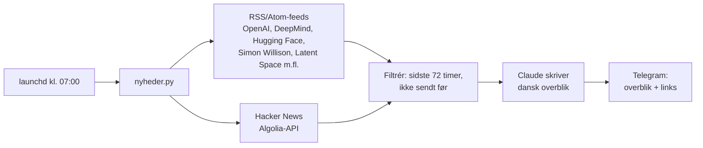

# AI-nyhedsbrief

Hver morgen kl. 7 får jeg en kort, teknisk AI-brief på dansk i Telegram. Et lille Python-script henter de nyeste artikler fra AI-labs og tekniske skribenter, lader Claude skrive et overblik og sender det som to beskeder: først overblikket, så linkene.

Jeg byggede det som et læringsprojekt for at lære automation lokalt på min egen Mac, uden en platform som n8n eller Make imellem.

## Sådan virker det



1. **Hent.** Læser RSS- og Atom-feeds med standardbiblioteket (`urllib` og `xml.etree`), ingen feed-bibliotek. Hacker News hentes via Algolia-søge-API'et og filtreres med en regex på AI-emner.
2. **Filtrér.** Kun artikler fra de sidste 72 timer. `sendt.json` husker, hvad der allerede er sendt, så intet kommer igen.
3. **Opsummér.** Claude får titler og uddrag og skriver et teknisk overblik på dansk.
4. **Send.** Beskeden deles op under Telegrams grænse på 4.096 tegn og sendes via Bot API.

## Robusthed (lært på den hårde måde)

| Hvad skete | Hvad jeg gjorde |
|---|---|
| Briefen udeblev, fordi Mac'en lige var vågnet fra dvale, og der ikke var net endnu (DNS-fejl kl. 07:04) | `vent_på_net()` venter op til 5 minutter på, at `api.telegram.org` kan slås op |
| Enkelte kald fejlede tilfældigt | `post_med_forsøg()` og `hent()` prøver 3 gange ved 5xx og timeout |
| Tom brief en stille weekend, fordi hnrss.org gav 502 | Skiftede til Hacker News' egen Algolia-API |
| Svært at se, hvad der skete hvornår | `=== Kørsel <tid> ===`-markør i både output- og fejllog |

## Kom i gang

```bash
python3 -m venv .venv
.venv/bin/pip install -r requirements.txt

cp hemmeligheder.env.eksempel hemmeligheder.env
chmod 600 hemmeligheder.env
# udfyld TELEGRAM_TOKEN (fra @BotFather) og ANTHROPIC_API_KEY,
# skriv en besked til din bot, og find så dit chat-ID:
.venv/bin/python find_chat_id.py

.venv/bin/python nyheder.py --test   # printer kun, sender ikke
.venv/bin/python nyheder.py          # sender til Telegram
```

**Kør hver morgen (macOS):** ret stierne i `dk.eksempel.ai-nyhedsbrief.plist`, kopiér den til `~/Library/LaunchAgents/`, og kør `launchctl load ~/Library/LaunchAgents/dk.eksempel.ai-nyhedsbrief.plist`.

**Kilder:** ret `FEEDS` øverst i `nyheder.py`.

## Sikkerhed

Nøgler ligger kun i `hemmeligheder.env` (chmod 600), som er i `.gitignore`. Scriptet læser filen selv, så nøglerne aldrig står i koden eller i miljøvariabler for andre processer.

---

**English:** A small Python script that runs every morning at 7 via launchd, fetches recent posts from AI labs and technical writers (RSS + Hacker News via Algolia), asks Claude to write a technical summary in Danish, and sends it to Telegram. Built as a learning project in local automation. Includes retry logic, wait-for-network after sleep, and deduplication across runs.

MIT-licens · Daniel Træholt
